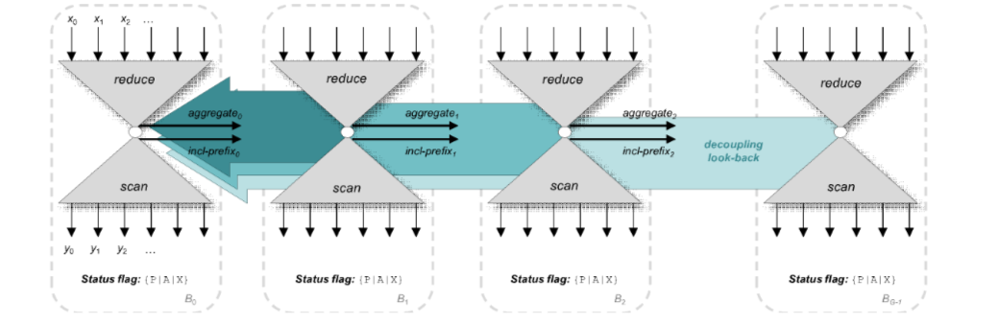
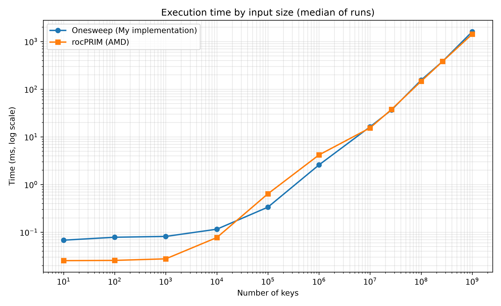

# SortTrack

An implementation of the Onesweep Least Significant Digit Radix Sort algorithm. This project was made with educational intent and is not meant for use in production software.

## References

Onesweep: A Faster Least Significant Digit Radix Sort for GPUs: https://arxiv.org/abs/2206.01784
Implementation by `b0nes164`: https://github.com/b0nes164/GPUSorting

## Implementation

Parallel radix sort works by slicing input numbers into groups of $n$ bits, where $n$ is a power of $2$. Each group is a collection of $2^n$ buckets. Each bucket stores the frequency of its index observed in the input forming a histogram. A parallel reduce then scan is performed over the histogram to obtain the exclusive prefix sum. Finally, the input is split into chunks with worker threads that calculate the relative displacement of its key in the output array using the pre-computed histogram.

This implementation results in $3n$ memory calls for every bit group, which quickly overwhelm compute and restrict the program's efficiency. 

Onesweep improves upon this model by replacing expensive $3n$ calls with $2n$ calls using decoupled lookback in the reduce then scan phase. 

### Global Histogram

Ahead of any chunk specific key offsets, we need to compute the first index of every bucket in the histogram. The `GlobalHistogram` kernel loads a chunk of the input into shared memory (in this case 1024 elements). Every worker thread in the chunk is assigned either one or multiple keys at once, the worker extracts the bits corresponding to the specified bit-group for all keys and performs an atomic addition on the global histogram stored in VRAM, to update the frequency of the matching bucket.

Once raw frequencies are collected and the histogram is ready, we execute a scan on it to get the exclusive prefix sum. This exclusive prefix sum holds the initial index for every bucket as specified by its index.

### Bin

The `Bin` kernel is responsible for computing the local offsets and final indices for all keys inside a chunk. The kernel utilizes three distinct phases to achieve success - Block Local Histogram, Decoupled Lookback and Scatter. The three phases work to find the block local key offset, wave local key rank and the final index in the scatter phase.

#### 1) Block Local Histogram

Every block (or chunk) receives $1024$ elements from the input. A block level histogram is necessary to find the offsets for every key in that block. In my implementation, a block is managed by $8$ waves of `wave32` format, therefore a combination of $256$ threads. Each thread manages 4 keys at offsets of one wave, i.e. $thread 0$ manages keys at indices $0, 32, 64, ...$, $thread 1$ manages indices $1, 33, 65,...$ and so on. Each wave inside a block is responsible for $128$ elements, and for each element the thread computes it's bit-group specific digit, and its local rank within the wave (how many elements in the same wave had the same digit before this key). The result of this phase is the block level histogram of 1024 keys. The wave local ranks are necessary to finally get the block specific rank

This operation takes $1n$ memory reads.

#### 2) Decoupled Lookback

Once the local histogram of the block is ready, we need its inclusive prefix scan (or aggregate). And the prefix sum of all previous block's aggregates (or their prefix sum). To represent the two values and their state we create a simple structure in memory that keeps track of every block's aggregates and prefix sums.

```
struct BlockState {
    uint32_t prefix_sum[BUCKET_COUNT];
    uint32_t aggregate[BUCKET_COUNT];
    uint8_t  status;
};
```

Decoupled lookback functions by computing its own aggregate, then executing a lookback phase that reads the aggregates of its previous block, stores it in a running total that represents the prefix scan and moving back to the next block. In case the lookback encounters a prefix sum along with the aggregate, the sum is added to the running total and lookback is terminated since the final prefix sum is obtained.


*Image from https://arxiv.org/abs/2206.01784

The prefix sum combined with block specific ranks gives us the exact offset of a key from the initial index of its corresponding bucket in the global histogram.

#### 3) Scatter

Once we have the global histogram, prefix sums and block local ranks for all blocks, we can calculate the final index of the key.

```
uint32_t digit = <computed key digit for the current bit-group>;
size_t final_index = global_histogram[digit] + prefix_sum[digit] + rank[key];
sorted_array[final_index] = key;
```

This phase makes $1n$ memory writes, bringing total memory references to $2n$.

## System Specifications

 - CPU: AMD Ryzen 7 8840HS
 - GPU: Radeon 780M (4 GB VRAM shared with host memory)
 - RAM: 32 GB DDR5 5600 MT/s 

## Results

Each time result here is the median of 5 runs where each run offers the average of 10 executions of the same kernel with the same randomized numbers. 

| Input Size | Onesweep (My implementation) | RocPRIM (AMD) | Speedup |
| --- | --- | --- | --- |
| 10 | 0.0680 | 0.0253 | 0.372 |
| 100 | 0.0783 | 0.0256 | 0.327 |
| 1,000 | 0.0815 | 0.0276 | 0.339 |
| 10,000 | 0.1155 | 0.0772 | 0.668 |
| 100,000 | 0.3352 | 0.6393 | 1.908 |
| 1,000,000 | 2.5776 | 4.1738 | 1.619 |
| 10,000,000 | 16.2331 | 15.4096 | 0.949 |
| 100,000,000 | 154.8469 | 146.4054 | 0.945 |
| 1,000,000,000 | 1605.9250 | 1424.6858 | 0.887 |



It is difficult to draw a conclusion on these results since a large of computation is hidden behind a memory block of the shared DDR5 memory. Further experiments using faster dedicated GPUs will result in clearer differences between the two implementations.

License: GNU GPL-3